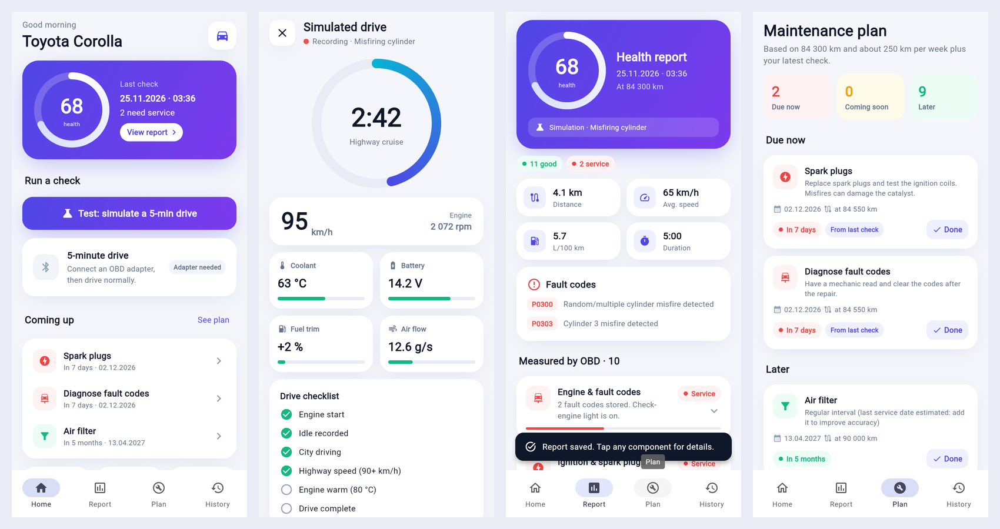

# CarPulse

Check your car's health with one 5-minute drive.

CarPulse reads your car's sensors through an OBD adapter, analyses a short drive and gives you:

- an overall **health score**
- the **condition of each key component**, with a plain-language explanation
- a **maintenance plan** showing what is due and when, in kilometres and dates

This first version runs on a **simulated car**, so no adapter or vehicle is needed yet. Tap **Test**, choose a fault (or a healthy car), and the app drives a virtual car along the same 5-minute route a real check would use.



## Run it on Windows

You need **Python 3.10 or newer**. If you don't have it, install it from [python.org](https://www.python.org/downloads/) and tick **"Add python.exe to PATH"** during setup.

1. Download this repository: on GitHub click **Code → Download ZIP** and unzip it, or use `git clone`.
2. Open **PowerShell** in the unzipped folder (in File Explorer, Shift + right-click the folder → "Open PowerShell window here").
3. Create a virtual environment and install the dependencies (first time only):

   ```powershell
   python -m venv .venv
   .venv\Scripts\Activate.ps1
   pip install -r requirements.txt
   ```

   If PowerShell refuses to run `Activate.ps1`, run `Set-ExecutionPolicy -Scope CurrentUser RemoteSigned` once, then try again.

4. Start the app:

   ```powershell
   python src\main.py
   ```

   A phone-sized window opens. Next time, only `.venv\Scripts\Activate.ps1` and `python src\main.py` are needed.

To run the tests: `python -m pytest`

Your vehicle and reports are saved in `%USERPROFILE%\.carpulse\carpulse.json`. Delete that file (or use **Reset all data** on the vehicle screen) to start over.

## How a check works

1. **Drive** for 5 minutes: cold start, idle, city driving, a highway stretch, then idle again. The live screen shows a countdown, the current phase, gauges and a checklist of the driving conditions recorded so far.
2. **Analyse.** Each component has its own rules based on typical values for petrol cars:

   | Component | What is checked |
   |---|---|
   | Engine & fault codes | Stored trouble codes (check-engine light) |
   | Battery | Resting voltage, voltage dip while starting, battery age |
   | Charging system | Voltage while driving (alternator) |
   | Cooling system | Highest coolant temperature, heat build-up at idle |
   | Thermostat | How fast and how far the engine warms up |
   | Fuel system | Fuel trims at idle and at cruise (lean or rich mixture) |
   | Air intake & air-flow sensor | Measured air flow compared with engine load |
   | Ignition & spark plugs | Misfire count and idle smoothness |
   | Oxygen sensors | How quickly the front sensor switches |
   | Catalytic converter | Rear vs. front oxygen-sensor activity |
   | Engine oil, brakes, tyres | Not visible over OBD: based on mileage and time since the last service |

3. **Plan.** Standard service intervals are combined with your odometer, your typical km per week and the check results. A fault moves the related job to the top. Tap **Done** when work is finished and the plan recalculates.

### Test scenarios

Healthy car, weak battery, failing alternator, thermostat stuck open, cooling problem, vacuum leak, dirty air-flow sensor, misfiring cylinder, worn catalytic converter, or **Surprise me** (one or two random faults, revealed in the report). The drive can run in real time (5 min), fast (30 s) or instant (5 s).

## Project layout

```
src/
├── main.py                 app entry point
└── carpulse/
    ├── models.py           data classes (samples, results, reports)
    ├── units.py            metric formatting (km, °C, L/100 km, dd.mm.yyyy)
    ├── storage.py          saves the profile and reports on the device
    ├── sources/
    │   ├── base.py         interface every data source implements
    │   └── simulator.py    the virtual car and its fault scenarios
    ├── analysis/
    │   ├── components.py   one scoring rule per component
    │   ├── maintenance.py  service intervals and the maintenance plan
    │   └── engine.py       turns a drive into a report
    └── ui/                 Flet screens, theme and animated widgets
tests/                      every scenario is checked to be detected correctly
```

## Roadmap

- **iPhone app.** The code is ready to package with `flet build ipa`. Apple requires a Mac with Xcode for that step.
- **Real OBD adapter.** iPhones only connect to Bluetooth Low Energy (BLE) or Wi-Fi adapters, such as the Vgate iCar Pro BLE, OBDLink CX or Veepeak BLE. A BLE data source will implement the same interface as the simulator (`sources/base.py`), so the rest of the app stays unchanged.
- **Android**, built from the same code with `flet build apk`.

Built with [Flet](https://flet.dev), which turns Python into Flutter apps.

> CarPulse gives guidance, not a professional diagnosis. Always have safety-critical parts such as brakes and tyres inspected by a mechanic.
